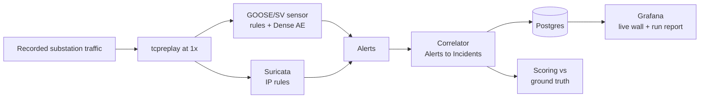

# IEC 61850 Detection Lab (in progress)

> **Work in progress.** This is a temporary README. The full write-up, measured results and run instructions will be added when the build is finished (target: early November 2026).

## The problem

In a digital substation, protection devices act on **GOOSE** messages, and by default those messages are not authenticated. A forged GOOSE message can trip a breaker, and a traffic flood can starve the network that protection depends on. Most SOC tooling can't see inside this traffic at all.

## What this lab does

It is a SOC-style monitoring pipeline for IEC 61850 substation traffic:

1. A fixed **Scenario** of recorded substation traffic (normal operation, a false data injection attack and a denial-of-service flood) is replayed at real speed over a network interface.
2. Two **sensors** watch it:
   - a custom Python GOOSE/SV sensor (rules plus a Dense autoencoder);
   - Suricata for IP traffic.
3. Their **Alerts** are grouped into **Incidents**, the unit an analyst actually handles.
4. Each run is **scored against ground truth** taken from the attacker's own packets, never from a detector.
5. Grafana dashboards show a live SOC wall during the run and a run report afterwards, with ATT&CK for ICS mappings and response playbooks.

## Why it's built this way

- **Incidents, not raw alert counts.** One forged-GOOSE attack can produce tens of thousands of per-frame alerts. The lab groups them into Incidents and reports those.
- **Alert burden as a first-class metric.** Every detector is measured by how many Alerts and Incidents per day it puts on an analyst during normal traffic, at several false-positive budgets.
- **Honest ground truth.** Attack intervals come from the attacker's packets, and the points where captures are stitched together are marked and kept out of scoring.
- **Generic and attack-aware rules reported separately.** A rule written only because you know how the attack works is labelled as such, so the results don't oversell what a defender would catch.
- **Defence, not just detection.** Each Incident family maps to ATT&CK for ICS (v20) and has a four-phase response playbook (triage, contain, investigate, recover), with the person acting named on every step.
